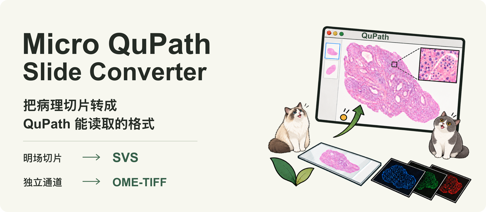
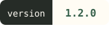
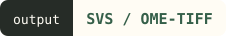
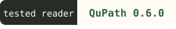
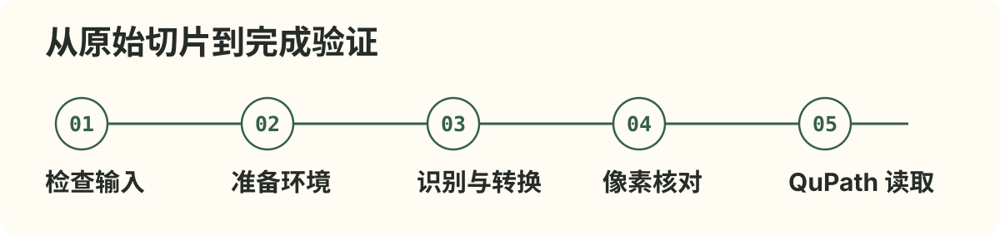

<picture>
  <source media="(max-width: 640px)" srcset="./assets/readme/hero-mobile.png">
  
</picture>

# Micro QuPath Slide Converter

**让打不开的病理切片，成为 QuPath 可读取的文件。**

这是供 **Codex 等 AI 助手调用的 Skill**。告诉助手原始切片的路径，它会检查文件、准备转换环境、选择输出格式，并验证 QuPath 能否读取结果，帮你完成图像分析前的文件准备。

<p>
  
  
  
  
</p>

## 能帮你做什么？

| 你提供的切片 | 你得到的结果 |
|---|---|
| 明场切片，如 H&E | **SVS**：在 QuPath 中查看整片，继续分析 |
| 含独立通道的荧光切片 | **OME-TIFF**：保留各通道，分别查看或叠加显示 |

原始文件保留，结果写入新目录，同时交付像素核对记录、QuPath 读取结果和转换日志。细胞检测、组织分割等后续分析需在 QuPath 中继续完成。

## 快速开始

1. 将完整的 `micro-qupath-slide-converter` 文件夹放入 AI 助手的 Skill 目录，并重新加载。
2. 准备完整切片及配套文件。当前自动环境准备与转换面向 **Linux x86_64**；首次安装需要联网和足够磁盘空间。
3. 将下面的路径替换成你的实际位置，发给助手：

```text
使用 micro-qupath-slide-converter，检查 /data/slides/sample/。
请确认切片格式和文件是否完整，选择合适的输出格式，
完成转换并验证 QuPath 能读取。缺少环境时请先准备依赖。
```

## 转换流程

<picture>
  <source media="(max-width: 640px)" srcset="./assets/readme/workflow-mobile.svg">
  
</picture>

## 支持范围

- **明场**：RGB 8 位、单平面／单时间点；含已支持的 JPEG KFB 1.6。
- **荧光**：独立 8／16 位通道、单平面／单时间点；KFBF 专用分支支持 2.1 版本的独立灰度 JPEG8。
- **其他格式**：NDPI、MRXS、CZI、SVS 等会先检查读取能力；能否转换取决于具体版本、编码和数据完整性。

已合成的 RGB 图片无法恢复原始独立通道。遇到缺失像素或未支持的格式，默认停止并说明原因。完整条件见[格式说明](references/formats.md)与[环境要求](references/environment.md)。

**已有实样验证**：四通道、六通道 KFBF 切片已完成转换、像素核对，并通过 QuPath 0.6.0 无界面读取。[查看验证记录](docs/validation-v1.2.0.md)

## 联系与共建

欢迎提出问题、分享使用体验，或建议希望支持的切片格式。让我们一起迭代这个 Skill，把生态做得更好。

如需联系作者，欢迎来信：[zwgitsachance@126.com](mailto:zwgitsachance@126.com)。

---

[完整使用说明](SKILL.md) · [验证与恢复](references/validation.md) · [测试方法](docs/testing.md) · [第三方许可](references/third-party-notices.md)

代码与文档采用 [MIT License](LICENSE)；第三方依赖与测试样本遵循各自许可。
